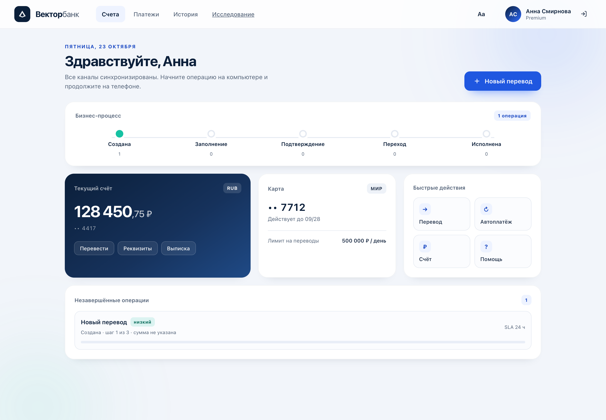
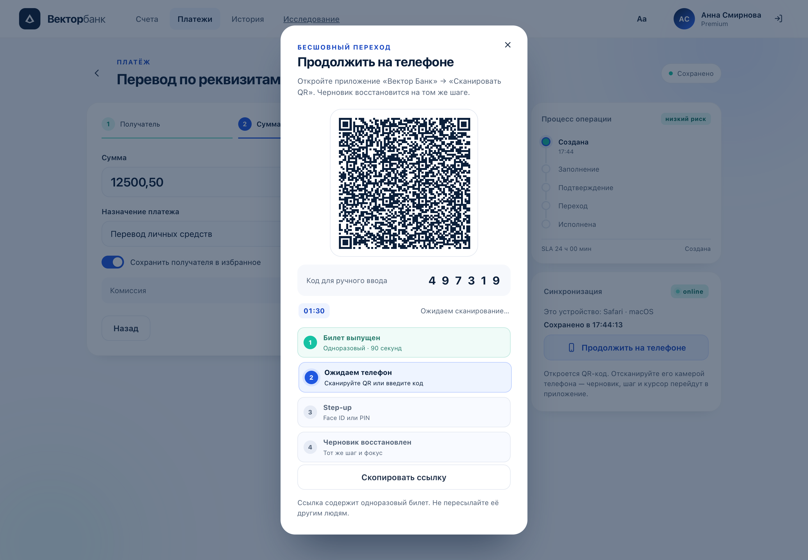
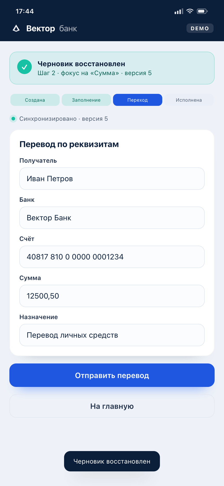

# Seamless Banking — прототип бесшовного перехода Web ↔ Mobile

Демонстрационная экосистема для магистерской диссертации
«Исследование преимущества бесшовного перехода в мобильных и веб-интерфейсах
банковских приложений» (09.04.02, Мосполитех).

Сценарий: клиент начинает перевод в интернет-банке, нажимает «Продолжить на телефоне»,
сканирует QR, подтверждает Face ID — и мобильное приложение открывает тот же черновик
на том же шаге, с тем же фокусом и позицией курсора. Веб-клиент в реальном времени
получает событие перехода и переходит в режим просмотра.

## Что нового в прототипе

- **Мобильный клиент умеет начинать перевод сам** — кнопка «Новый перевод» создаёт черновик после step-up, его можно открыть на веб-клиенте из списка операций. Переход стал двусторонним, а не только web → mobile.
- **На главном экране мобильного клиента появилась процессная карта**: стадия, прогресс, риск и SLA текущей операции — та же бизнес-модель, что в веб-клиенте.
- **Веб-клиент показывает живую timeline перехода** (билет → телефон → step-up → черновик) и измеренное время перехода в баннере.
- **Мобильный step-up стал анимированным**: Face ID-кольца, PIN-клавиатура, haptic feedback; демо-PIN `0000`.
- **Избранные получатели**: `GET/POST/DELETE /v1/recipients`, чипы на веб-шаге 1 и лента на главном экране Flutter; получатель сохраняется после перевода.
- Добавлены тесты парсинга процессной модели; `flutter analyze` — без ошибок, `flutter build web --release` — успешно.

## Скриншоты

| Интернет-банк | QR-переход | Мобильный клиент |
|---|---|---|
|  |  |  |

## Быстрый старт

```bash
# 1. зависимости
pnpm install

# 2. один запуск демо: API + health + браузер
./scripts/demo.sh

# остановить
./scripts/demo-stop.sh
```

Или вручную:

```bash
pnpm start
# http://localhost:8787      — интернет-банк
# http://localhost:8787/m    — демо-стенд мобильного клиента
# http://localhost:8787/admin — админ-панель (код ADMIN-2026)
# http://localhost:8787/research — панель исследования
# http://localhost:8787/v1/health
```

С Redis (рекомендуется для проверки архитектуры):

```bash
docker compose -f infra/docker-compose.yml up --build
# или локально:
REDIS_URL=redis://127.0.0.1:6379 pnpm start
```

### Демонстрация за 60 секунд

1. Откройте `http://localhost:8787`, войдите (код `0000`).
2. «Новый перевод» → заполните получателя → «Далее» → сумму и назначение.
3. «Продолжить на телефоне» — появится QR и шестизначный код.
4. В новой вкладке откройте `http://localhost:8787/m`, войдите, нажмите
   «Последний QR» (ссылка и код уже в `localStorage`) → «Продолжить».
5. «Подтвердить и продолжить» (Face ID или PIN `0000`).
6. Черновик восстановлен: шаг, поля, фокус. Отправьте перевод.
7. В первой вкладке появится баннер «Операция продолжена на iPhone 15 · iOS».

## Состав

```
seamless-banking/
├── apps/
│   ├── api/        Fastify 5 · REST · WebSocket · Redis · QR · метрики
│   ├── web/        PWA: личный кабинет + демо-стенд мобильного клиента
│   └── mobile/     Flutter-клиент: сканирование, Face ID, подхват черновика
├── packages/
│   └── contracts/  OpenAPI 3.1
├── infra/
│   ├── docker-compose.yml
│   └── k6/load-test.js
├── tests/          E2E: web → mobile → submit
├── docs/           ARCHITECTURE.md, скриншоты
└── scripts/        ui-flow.mjs (Playwright-прогон + скриншоты)
```

## API (кратко)

| Метод | Путь | Назначение |
|---|---|---|
| POST | `/v1/auth/demo-login` | вход (web/mobile) |
| POST | `/v1/auth/step-up` | подтверждение личности |
| POST | `/v1/drafts` | создать черновик |
| PATCH | `/v1/drafts/{id}` | сохранить поля + контекст |
| POST | `/v1/handoff/ticket` | одноразовый билет + QR + код |
| POST | `/v1/handoff/preview` | предпросмотр операции |
| POST | `/v1/handoff/redeem` | погасить билет и получить черновик |
| POST | `/v1/drafts/{id}/submit` | отправить перевод |
| WS | `/v1/stream` | `draft.updated`, `handoff.redeemed`, `submitted` |
| GET | `/v1/processes` | процессы клиента: стадия, SLA, риск |
| GET | `/v1/admin/processes` | все процессы и статистика по стадиям |
| GET | `/v1/research/overview` | гипотезы, метрики, имитация |
| POST | `/v1/research/sessions` | сохранить измерение |
| GET | `/v1/metrics` | p50/p95/p99 задержек и счетчики |

Полный контракт — [packages/contracts/openapi.yaml](packages/contracts/openapi.yaml).

## Нативные сборки

| Платформа | Артефакт | Статус |
|---|---|---|
| Android | `dist/VectorBank-android-release.apk` | собран, установлен на Pixel_5 |
| iOS | `dist/VectorBank-ios-unsigned.ipa` | собран arm64 device, без подписи |

Подробности и команды: [docs/NATIVE_BUILD.md](docs/NATIVE_BUILD.md).  
Скрипты: `scripts/build_android.sh`, `scripts/build_ios.sh`.

Ограничения: Android APK подписан debug-ключом; iOS не подписан, для устройства нужен Apple Developer certificate. MLKit не поддерживает arm64-симулятор iOS 26.

## Тесты

```bash
pnpm test          # E2E: вход → черновик → QR → step-up → redeem → конфликт → submit
cd apps/mobile && flutter test   # модель ProcessInfo: стадия, риск, SLA
```

Дополнительно: `node scripts/load-check.mjs` — локальная проверка задержки PATCH
(1 500 запросов, 50 конкурентных клиентов).

B2B-минимум: RBAC (client/support/analyst/admin), аудит с hash chain, аналитика
воронки и экспорт CSV/JSON. Подробно — [docs/B2B_MINIMUM.md](docs/B2B_MINIMUM.md).

Проверяются, в частности:

- CRR = 100 % для переданных полей, шага и контекста;
- `redeem` без step-up → 403;
- повторный `redeem` → 409 `ALREADY_REDEEMED`;
- запись с веба после перехода → 409 `LEASE_HELD`;
- `claim` возвращает управление;
- WebSocket-события `handoff.redeemed` и `draft.submitted`;
- метрики задержки синхронизации;
- RBAC: client → 403 на админ-эндпоинтах, admin → 200;
- целостность аудита (hash chain) и экспорт CSV/JSON.

## Обновление интерфейса

Service worker работает по схеме **network-first**: при наличии сети браузер получает
свежие HTML/JS/CSS, кэш используется только как fallback. При выходе новой версии
старый кэш удаляется, страница перезагружается автоматически. Если вы видите старый
интерфейс, выполните жёсткое обновление (Ctrl+Shift+R / Cmd+Shift+R) или удалите
данные сайта — это сбросит устаревший service worker.

## Переменные окружения

| Переменная | По умолчанию | Назначение |
|---|---|---|
| `PORT` | `8787` | порт API |
| `HOST` | `0.0.0.0` | интерфейс |
| `REDIS_URL` | — | если пусто, in-memory хранилище |
| `JWT_SECRET` | dev-секрет | HMAC-подпись токенов и билетов |
| `TICKET_TTL_SEC` | `90` | срок жизни билета |
| `LEASE_TTL_MS` | `30000` | аренда записи |
| `DRAFT_TTL_SEC` | `86400` | срок жизни черновика |
| `LOG_LEVEL` | `info` | уровень логов |

## Безопасность

- Одноразовый билет: `jti` + `GETDEL` в Redis; повторное погашение невозможно.
- Step-up обязателен: мобильный `redeem` без `authLevel = 2` → 403.
- QR не содержит ПДн — только подписанный билет.
- Lease + версия исключают конкурентную запись.
- Rate limiting на вход, выпуск билетов и погашение.
- Демо-контур: HMAC и HTTP; в промышленном — OIDC/RS256, KMS, TLS, WAF.

## Продуктовое развитие

- [PRODUCT_BACKLOG.md](docs/PRODUCT_BACKLOG.md) — 26 функций, приоритеты, MVP-аналоги,
  стресс-тест реализуемости и научной ценности.
- [B2B_MINIMUM.md](docs/B2B_MINIMUM.md) — RBAC, аудит, аналитика, экспорт.
- [BUSINESS_PROCESS_UI.md](docs/BUSINESS_PROCESS_UI.md) — визуализация бизнес-процесса.
- [RESEARCH_DASHBOARD.md](docs/RESEARCH_DASHBOARD.md) — панель исследования, гипотезы, сессии.
- [infra/postgres/schema.sql](infra/postgres/schema.sql) — схема пилота.
- [ENTERPRISE_ARCHITECTURE.md](docs/ENTERPRISE_ARCHITECTURE.md) — целевая архитектура
  пилота: PostgreSQL, Keycloak, очереди, аудит, RBAC/ABAC, SLO и дорожная карта.

## Связь с диссертацией

- Глава 2: конечный автомат, Draft State Cache, протокол перехода, дизайн-система.
- Глава 3: прототип, тестирование, эксперимент, метрики M1–M38.
- `docs/ARCHITECTURE.md` — источник для разделов 2.1–2.3 и 3.1–3.2.

## Ограничения

- Один демо-пользователь (`user_42`), платёжное ядро отсутствует.
- Flutter-клиент требует `flutter create .` и разрешений камеры/биометрии
  (см. [apps/mobile/README.md](apps/mobile/README.md)).
- `/m` — упрощённый браузерный стенд для проверки протокола, не замена Flutter-приложению.
