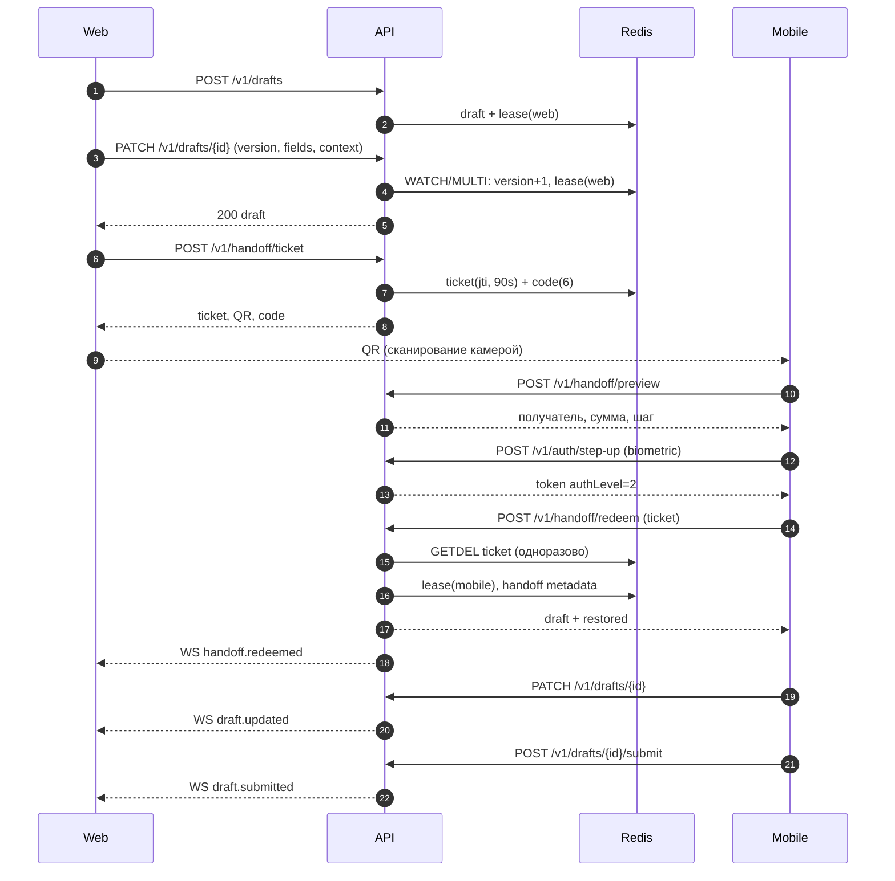

# Архитектура прототипа Seamless Banking

Документ фиксирует архитектурные решения прототипа, реализующего бесшовный переход
между веб- и мобильным интерфейсом банковского приложения. Прототип — демонстрационный:
реальные персональные данные и платёжное ядро не подключены.

## 1. Цели и ограничения

| Цель | Проверяемый критерий |
|---|---|
| Перенести черновик операции без повторного ввода | CRR = 100 % для переданных полей |
| Сохранить шаг сценария, фокус, каретку и прокрутку | Совпадение контекста после `redeem` |
| Обеспечить интерактивную задержку | p95 синхронизации ≤ 150 мс |
| Исключить повторное использование билета | Повторный `redeem` → HTTP 409 |
| Не допустить запись с двух устройств одновременно | Lease + версия; конфликт → HTTP 409 |
| Соблюсти требования безопасности и доступности | Step-up 100 %, QR без ПДн, WCAG 2.2 AA |

Ограничения демо-контура: один демо-пользователь, HMAC-подпись вместо KMS/OIDC,
in-memory fallback при недоступности Redis, отсутствие TLS-терминации.

## 2. Компоненты

```
┌────────────────────┐        HTTPS / WSS         ┌──────────────────────────┐
│  Web (React-free   │  REST + WebSocket          │  Fastify API             │
│  PWA, apps/web)    │◄──────────────────────────►│  • auth / step-up        │
└────────────────────┘                            │  • drafts / lease        │
                                                  │  • handoff ticket        │
┌────────────────────┐        HTTPS / WSS         │  • WebSocket hub         │
│  Mobile (Flutter,  │◄──────────────────────────►│  • metrics               │
│  apps/mobile)      │                            └───────────┬──────────────┘
└────────────────────┘                                        │
                                                              │ Redis Pub/Sub
                                                  ┌───────────▼──────────────┐
                                                  │  Redis 7                 │
                                                  │  sess / draft / ticket   │
                                                  │  code / redeemed         │
                                                  └──────────────────────────┘
```

| Компонент | Ответственность | Технология |
|---|---|---|
| Web-клиент | Личный кабинет, форма перевода, автосохранение, QR-модалка | HTML + ES-модули + CSS, PWA |
| Mobile-клиент | Вход, сканирование QR, step-up, подхват и отправка | Flutter 3, Material 3 |
| API | Аутентификация, черновики, lease, handoff, WS, метрики | Fastify 5, Node.js 20+ |
| Хранилище | Сессии, черновики, билеты, коды, статусы | Redis 7 (fallback — память) |
| Контракты | Единая схема API | OpenAPI 3.1 |
| Наблюдаемость | Счетчики и перцентили задержек | `/v1/metrics`, JSON-логи |

## 3. Последовательность перехода



## 4. Модель данных

### Черновик

```json
{
  "id": "op_...",
  "userId": "user_42",
  "status": "draft",
  "version": 5,
  "step": 2,
  "totalSteps": 3,
  "fields": {
    "recipientName": "Иван Петров",
    "recipientBank": "Вектор Банк",
    "recipientAccount": "40817...",
    "amount": "12500,50",
    "currency": "RUB",
    "purpose": "Перевод личных средств",
    "fee": "0",
    "saveTemplate": false
  },
  "context": {
    "focus": "amount",
    "caret": 5,
    "scroll": 240,
    "validation": {},
    "a11y": { "fontScale": 1, "contrast": "normal", "reduceMotion": false },
    "locale": "ru-RU"
  },
  "lease": { "deviceId": "ios_...", "deviceName": "iPhone 15 · iOS", "expiresAt": 1790000000000 },
  "handoff": { "jti": "...", "createdAt": "...", "redeemedAt": "...", "redeemedBy": {} },
  "updatedAt": "2026-10-19T19:40:00.000Z",
  "updatedBy": { "deviceId": "web_...", "deviceName": "Chrome · macOS", "channel": "web" }
}
```

### Ключи Redis

| Ключ | Тип | TTL | Назначение |
|---|---|---|---|
| `sess:{sid}` | string (JSON) | 12 ч | Сессия устройства, `authLevel` |
| `draft:{opId}` | string (JSON) | 24 ч | Черновик, версия, lease, handoff |
| `user:{uid}:drafts` | set | 24 ч | Индекс операций пользователя |
| `ticket:{jti}` | string (JSON) | 90 с | Одноразовый билет |
| `code:{code}` | string | 90 с | Шестизначный код → jti |
| `redeemed:{jti}` | string (JSON) | 10 мин | Факт погашения (для статуса) |

Атомарность: `WATCH/MULTI/EXEC` для версионирования черновика; `GETDEL` для билета;
`SET NX EX` для выпуска билета и кода.

## 5. Конечный автомат сессии

| Состояние | Событие | Переход | Условие |
|---|---|---|---|
| `EDIT_WEB` | `PATCH` | `EDIT_WEB` | lease принадлежит web, версия совпадает |
| `EDIT_WEB` | `TICKET_ISSUED` | `HANDOFF_PENDING` | владелец операции |
| `HANDOFF_PENDING` | `PREVIEW` | `HANDOFF_PENDING` | билет валиден, не погашен |
| `HANDOFF_PENDING` | `STEP_UP` | `HANDOFF_PENDING` | mobile, proof валиден |
| `HANDOFF_PENDING` | `REDEEM` | `EDIT_MOBILE` | step-up, билет одноразовый, тот же пользователь |
| `HANDOFF_PENDING` | `TTL_EXPIRED` | `EXPIRED` | 90 с |
| `EDIT_MOBILE` | `PATCH` | `EDIT_MOBILE` | lease у mobile |
| `EDIT_MOBILE` | `CLAIM_WEB` | `EDIT_WEB` | web, authLevel 2 |
| `EDIT_WEB`/`EDIT_MOBILE` | `SUBMIT` | `SUBMITTED` | обязательные поля заполнены |
| `SUBMITTED` | `PATCH`/`REDEEM` | — | 409 `DRAFT_LOCKED` |

Инварианты:

- **I1.** Переход в `EDIT_MOBILE` невозможен без `authLevel = 2`.
- **I2.** Билет погашается ровно один раз (`GETDEL`).
- **I3.** Билет привязан к `userId` инициатора.
- **I4.** Версия черновика монотонно возрастает.
- **I5.** Запись разрешена только держателю lease (или при истёкшем lease).

## 6. Синхронизация и конфликты

- **Версия.** Каждый `PATCH` увеличивает `version`; клиент присылает `baseVersion`.
  Несовпадение → `409 VERSION_CONFLICT` и актуальный черновик в теле ошибки.
- **Lease.** Аренда записи на 30 с; продлевается каждым `PATCH`. Второе устройство
  получает `409 LEASE_HELD`, пока не выполнит `claim` (требует `authLevel = 2`).
- **Идемпотентность.** Патч полей — операция «слияние»; повтор с той же версией
  не проходит, но повторная доставка WS-события безопасна (клиент применяет снимок).
- **Транспорт.** WebSocket для push, REST для команд. При обрыве WS клиент
  переподключается и получает актуальный снимок через `GET /v1/drafts/{id}`.
- **Fallback.** Web дополнительно опрашивает `GET /v1/handoff/{jti}/status` раз в 2 с,
  если WS недоступен.

## 7. API

| Метод | Путь | Назначение |
|---|---|---|
| POST | `/v1/auth/demo-login` | Вход, выдача токена |
| POST | `/v1/auth/step-up` | Повышение уровня аутентификации |
| GET | `/v1/me` | Профиль и сессия |
| POST | `/v1/drafts` | Создать черновик |
| GET | `/v1/drafts` | Список операций |
| GET | `/v1/drafts/{id}` | Черновик |
| PATCH | `/v1/drafts/{id}` | Сохранить поля/шаг/контекст |
| POST | `/v1/drafts/{id}/claim` | Вернуть управление |
| POST | `/v1/drafts/{id}/submit` | Отправить перевод |
| POST | `/v1/handoff/ticket` | Выпустить билет + QR + код |
| POST | `/v1/handoff/preview` | Предпросмотр операции |
| POST | `/v1/handoff/redeem` | Погасить билет |
| GET | `/v1/handoff/{jti}/status` | Статус билета |
| WS | `/v1/stream?token=` | События `draft.updated`, `handoff.redeemed`, `lease.claimed`, `draft.submitted` |
| GET | `/v1/metrics` | Счетчики и перцентили |

Контракт: [`packages/contracts/openapi.yaml`](../packages/contracts/openapi.yaml).

## 8. Безопасность

### Модель угроз (STRIDE)

| Угроза | Вектор | Мера | Проверка |
|---|---|---|---|
| Spoofing | Подделка токена/билета | HMAC-SHA256, `aud`, `typ`, `exp` | Тест подписи |
| Tampering | Изменение полей в пути | Серверная валидация, версии | Валидация + 409 |
| Repudiation | Отрицание перехода | `handoff` metadata, логи | Аудит |
| Information disclosure | ПДн в QR/ссылке | QR содержит только билет; preview маскирует | Ревизия payload |
| DoS | Флуд `redeem` | Rate limit 20/мин, body limit 512 КБ | 429 |
| Elevation of privilege | Переход без биометрии | `authLevel = 2` обязателен | 403 `STEP_UP_REQUIRED` |
| Replay | Повторный redeem | Одноразовый `jti`, `GETDEL` | 409 `ALREADY_REDEEMED` |
| Session fixation | Навязанный `sid` | `sid` генерирует сервер | Тест |
| CSRF | Cookies | Bearer-токен, не cookie | Архитектурно |
| QR-фишинг | Подмена QR | Показ получателя/суммы + step-up | UX-проверка |

Дополнительно: TTL билета 90 с, лимит попыток, отсутствие ПДн в QR, `claim` только
после повторной аутентификации, журналирование событий перехода.

### Про PKCE

В классическом OAuth PKCE защищает authorization code flow нативного приложения.
В данном протоколе мобильный клиент уже имеет собственную аутентифицированную сессию,
поэтому центральным механизмом является **одноразовый билет + привязка к пользователю
+ обязательный step-up**. PKCE остаётся уместным для OAuth-входа самого мобильного
приложения (RFC 7636, RFC 8252) и вынесен за границы прототипа; это осознанное
уточнение исходной гипотезы, а не её отмена.

### Ограничения демо

- HMAC-секрет в переменной окружения; в промышленном контуре — KMS/HSM или RS256.
- Нет шифрования полей черновика на уровне приложения (только TLS в проде).
- Нет OIDC-провайдера и реальной биометрии (эмуляция через `local_auth`).
- Нет CSP-заголовков и WAF.

## 9. Производительность

Бюджет задержки синхронизации:

| Участок | Оценка, мс |
|---|---|
| Сеть клиент → API | 30–50 |
| Валидация + маршрутизация Fastify | 2–4 |
| Чтение/запись Redis (WATCH/MULTI) | 2–5 |
| Сериализация и публикация в Pub/Sub | 2–4 |
| Доставка WebSocket | 10–20 |
| **Итого p50** | **~55–80** |
| **Цель p95** | **≤ 150** |

Нагрузочный сценарий: k6, 50–500 VU, `PATCH` + периодический `ticket`; пороги
`p(95) < 150 мс`, `p(99) < 300 мс`, ошибки < 1 %. Замеры сервера — в `/v1/metrics`
(`syncLatencyMs`).

## 10. Наблюдаемость

`GET /v1/metrics` возвращает:

```json
{
  "store": "memory",
  "counters": {
    "logins": 2, "stepUps": 1, "draftsCreated": 1, "patches": 4,
    "conflicts": 1, "ticketsIssued": 1, "handoffsRedeemed": 1, "submissions": 1
  },
  "syncLatencyMs": { "count": 5, "p50": 0, "p95": 1, "p99": 1, "max": 1 },
  "clientSyncLatencyMs": { "count": 2, "p50": 1, "p95": 1, "p99": 1, "max": 1 },
  "handoffLatencyMs": { "count": 1, "p50": 2806, "p95": 2806 },
  "redeemLatencyMs": { "count": 1, "p50": 1, "p95": 1 }
}
```

Метрики — основа для расчёта M10–M15 (задержка, CRR, HSR) в главе 3 диссертации.

## 11. Отказоустойчивость

| Отказ | Поведение |
|---|---|
| Redis недоступен на старте | Fallback в память, предупреждение в лог |
| Redis недоступен в работе | 503 `WRITE_CONTENTION`; клиент повторяет |
| WebSocket оборван | Реконнект через 2,2 с, добор снимка по REST |
| Билет истёк | 409, пользователь запрашивает новый |
| Два устройства пишут одновременно | Lease + версия, 409 с актуальным черновиком |

## 12. Архитектурные решения (ADR)

| № | Решение | Альтернатива | Причина |
|---|---|---|---|
| ADR-1 | Одноразовый билет + step-up | PKCE для handoff | Мобильный клиент уже аутентифицирован; PKCE не решает привязку к пользователю |
| ADR-2 | Lease + версия | CRDT/OT | Банковская форма — один активный писатель; CRDT избыточен |
| ADR-3 | WebSocket + polling fallback | Только SSE | Нужен двусторонний канал и heartbeat |
| ADR-4 | Redis Pub/Sub | Kafka | Демо-масштаб; Kafka — для промышленного event bus |
| ADR-5 | Web без фреймворка | React/Vite | Минимум сборки, воспроизводимость демо; архитектура не зависит от UI-стека |
| ADR-6 | In-memory fallback | Обязательный Redis | Демо должно запускаться одной командой |

## 13. Что не входит в прототип

- Реальное платёжное ядро, АБС, антифрод-скоринг.
- OIDC/Keycloak, RS256, KMS, mTLS.
- Шифрование полей на уровне приложения и tokenization карт.
- Горизонтальное масштабирование WebSocket (sticky sessions / Redis adapter).
- Полный аудит-трейл в неизменяемом хранилище (WORM).
- Сертификация по ГОСТ Р 57580.1-2017 и оценка соответствия по 57580.2-2018.
