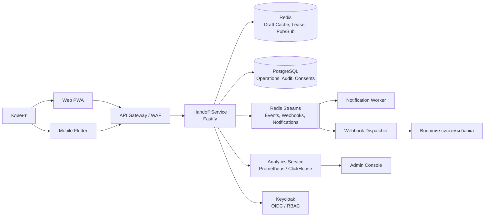

# Целевая архитектура платформы Seamless Handoff

Документ описывает, как демонстрационный прототип превращается в пилотное
B2B-решение банка. Он не заменяет `ARCHITECTURE.md` (архитектура прототипа),
а задаёт целевую рамку и границы изменений.

## 1. Принципы

1. **Состояние операции не принадлежит каналу.** Web, PWA и mobile — проекции
   одного домена `operation`.
2. **Один активный писатель.** Lease + версия вместо распределённых блокировок.
3. **Безопасность по умолчанию.** Одноразовый билет, step-up, аудит, минимизация ПДн.
4. **Эволюция, а не революция.** Демо-контур на Redis заменяется PostgreSQL и
   OIDC по мере роста, без переписывания протокола.
5. **Наблюдаемость как функция.** Каждый переход и каждая задержка измеряются.

## 2. Текущий и целевой контур

| Слой | Демо (сейчас) | Пилот (цель) | Когда менять |
|---|---|---|---|
| Клиенты | PWA + Flutter | те же + нативная сборка | после пилота |
| Вход | demo-login, HMAC | Keycloak OIDC, RS256 | этап 1 |
| API | Fastify, REST + WS | Fastify + API Gateway | этап 2 |
| Черновики | Redis | Redis (кэш) + PostgreSQL (SoR) | этап 1 |
| Аудит | events в памяти/Redis | PostgreSQL append-only + hash chain | этап 1 |
| Очереди | in-process | Redis Streams / BullMQ | этап 3 |
| Аналитика | `/v1/metrics` | Prometheus + ClickHouse | этап 2 |
| ML | нет | Python/FastAPI, логистическая регрессия | после пилота |
| Секреты | env | Vault/KMS | этап 4 |

## 3. Контейнеры (C4, уровень 2)



Правила:

- Gateway терминирует TLS, применяет rate limit и WAF; не хранит состояние.
- Handoff Service — единственный владелец жизненного цикла операции.
- PostgreSQL — система записи для завершённых операций, аудита и согласий;
  Redis — оперативный кэш и очередь.
- Аналитика читает события, но не влияет на транзакционный путь.

## 4. Данные

### 4.1. Основные сущности

| Таблица | Ключ | Назначение |
|---|---|---|
| `users` | `user_id` | клиент, сегмент, контакты (минимизированные) |
| `devices` | `device_id` | устройство, канал, отпечаток, доверенность |
| `operations` | `op_id` | операция: продукт, статус, сумма, валюта |
| `drafts` | `op_id`, `version` | версии черновика (JSONB), lease, контекст |
| `handoff_tickets` | `jti` | билет: TTL, статус, привязка к устройству |
| `audit_events` | `event_id` | append-only, `prev_hash`, `hash` |
| `consents` | `consent_id` | согласия 152-ФЗ, срок, версия текста |
| `webhooks` | `hook_id` | URL, секрет, события, retry-политика |
| `experiments` | `experiment_id` | A/B, варианты, метрика |

### 4.2. Аудит с hash chain

```
hash_i = SHA256(event_i || hash_{i-1})
```

Проверка целостности — пересчёт цепочки; разрыв означает вмешательство.
Запись — только append, обновление и удаление запрещены на уровне роли БД.

### 4.3. Сроки хранения

| Данные | Срок | Основание |
|---|---|---|
| Черновик | 24 ч | минимизация, 152-ФЗ |
| Билет | 90 с | безопасность |
| Аудит перехода | 3 года | 683-П, внутренний регламент |
| Согласие | срок действия + 3 года | 152-ФЗ |
| Метрики (обезличенные) | 13 месяцев | аналитика |

## 5. RBAC и ABAC

### 5.1. Роли

| Роль | Клиент | Support | Analyst | Admin |
|---|---|---|---|---|
| Свои операции | CRUD | R | R | R |
| Чужие операции | — | R (маскировано) | — | R |
| Возврат управления (claim) | да | да | — | да |
| Аудит | — | R | R | R |
| Экспорт | свои | — | R | R |
| Флаги/конфиг | — | — | — | CRUD |

### 5.2. ABAC-правила

- доступ к черновику: `user_id == sub` **или** роль `support/admin`;
- запись: lease принадлежит устройству **и** `authLevel = 2`;
- экспорт: только обезличенные поля, кроме роли `admin`;
- step-up: новое устройство, смена сети, сумма выше порога.

## 6. События

| Событие | Источник | Потребители |
|---|---|---|
| `operation.created` | Handoff | аналитика |
| `draft.updated` | Handoff | WebSocket, аудит |
| `handoff.ticket_issued` | Handoff | аналитика, аудит |
| `handoff.redeemed` | Handoff | WebSocket, webhooks, аудит |
| `handoff.expired` | Handoff | уведомления |
| `operation.submitted` | Handoff | webhooks, аналитика |
| `audit.appended` | Audit | архив |

Конверт: `event_id`, `type`, `occurred_at`, `producer`, `subject`, `payload`,
`trace_id`, `schema_version`. Доставка — at-least-once, потребители идемпотентны
по `event_id`.

## 7. SLO и метрики

| SLO | Цель | Окно |
|---|---|---|
| Доступность API | 99,9 % | 30 дней |
| p95 синхронизации | ≤ 150 мс | 5 мин |
| p99 синхронизации | ≤ 300 мс | 5 мин |
| Доля успешных handoff | ≥ 99 % | 24 ч |
| Ошибки 5xx | ≤ 0,1 % | 5 мин |
| Время экспорта 10 тыс. строк | ≤ 5 с | сутки |

Алерты: burn-rate по ошибкам, рост p95, очередь вебхуков, расхождение hash chain.

## 8. Развёртывание

### Демо

`docker compose`: api, redis, web, mobile (эмулятор), prometheus (опционально).

### Пилот

- Kubernetes: 2+ реплики Handoff, HPA по CPU/RPS;
- PostgreSQL managed (Patroni/Cloud), Redis Sentinel/Cluster;
- Keycloak HA;
- ingress + WAF, cert-manager;
- Vault/KMS;
- OpenTelemetry Collector → Tempo/Jaeger, Prometheus, Grafana, Loki.

### Резервное копирование

- PostgreSQL PITR, ежедневный полный дамп, проверка восстановления раз в квартал;
- Redis — кэш, не источник истины; потеря допустима;
- аудит — отдельный бакет с WORM.

## 9. Дорожная карта

| Этап | Срок | Результат |
|---|---|---|
| 0. Демо | готово | прототип, E2E, Redis, a11y |
| 1. B2B-минимум | 3 недели | RBAC, аудит, экспорт, PostgreSQL |
| 2. Пилот | 4 недели | OIDC, воронка, SLO, what-if |
| 3. Интеграции | 4 недели | webhooks, очередь, уведомления, флаги |
| 4. Исследование | 2 недели | SUS/CES, A/B, отчёт |
| 5. Зрелость | 6 недель | ABAC, KMS, multi-tenant |

## 10. Риски и анти-паттерны

| Риск | Проявление | Мера |
|---|---|---|
| Distributed monolith | 10 сервисов на одном узле | 3–4 сервиса на пилот |
| Eventual consistency | черновик «мигает» | lease + версия + snapshot |
| Audit как логи | нельзя доказать целостность | hash chain, WORM |
| ML на demo-данных | ложная точность | только эвристика/логистика с оговоркой |
| Секреты в env | утечка при логировании | Vault/KMS, запрет логов |
| Перегрузка UI | «всё в одном экране» | поэтапные экраны, прогрессивное раскрытие |

## 11. Что не входит в пилот

- реальное платёжное ядро и АБС (только anti-corruption layer/mock);
- Kafka и ClickHouse (Redis Streams и PostgreSQL достаточны до 50 тыс. операций/сутки);
- multi-tenant изоляция по банкам (после подтверждения спроса);
- биометрическая ЕБС (интеграция с банком).
